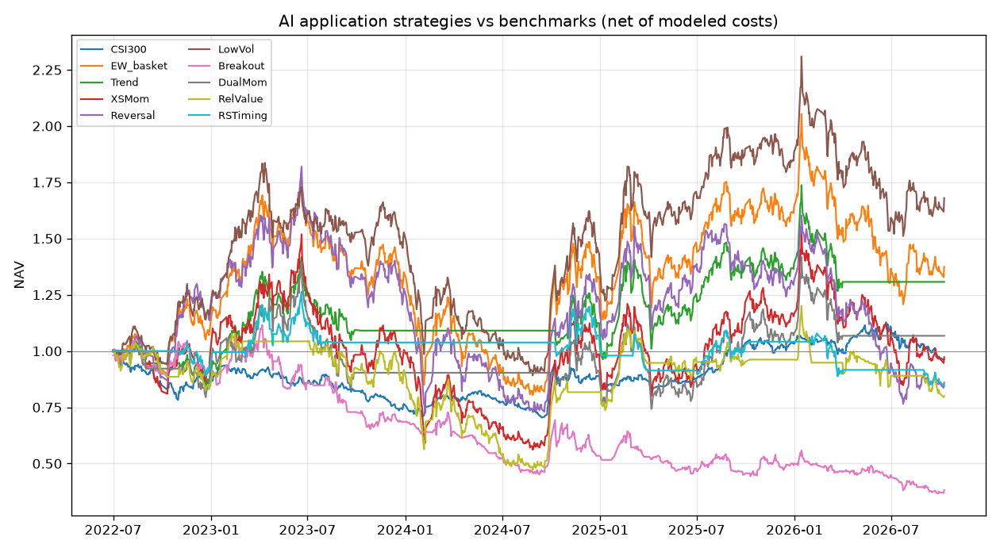

# A股 AI 应用交易策略研究

- 研究日期：2026-10-12（Asia/Shanghai）
- 完整日线截止：2026-10-09（最后一根已收盘 K 线）
- 盘中快照：2026-10-12 成分快照约 11:30:00，只描述当天状态，不作为成交价
- 可执行实现：`scripts/trading_strategy_research/ai_app_20261012.py`
- 结论先行：下面的排名只承认扣费后的回测结果。概念成分是 2026-10-12 的当前名单，历史回测含幸存者/事后入选偏差，因此即使统计上好看，也不把结果写成已经证明的事前 edge。

## 1. Executive Summary

本次没有策略通过质量门槛。不能声称 A 股 AI 应用里已经找到可部署 edge。沪深300自 2022-07-01 以来 CAGR -0.9%、夏普 0.03、最大回撤 -29.7%；扣费后的等权 AI 应用篮子 CAGR 8.1%、夏普 0.39、最大回撤 -54.7%。样本外夏普最高的研究记录是低波动（全样本夏普 0.54，样本外夏普 0.54，超额 CAGR 5.4%），未过门槛的原因：全样本夏普未高于1；全样本最大回撤深于30%；样本外夏普未高于0.7。

## 2. Market Analysis

### 2.1 市场状态

截止 2026-10-09，上证指数收于 3813.79，近120日 -4.3%，状态为震荡；沪深300收于 4317.26，近20/60/120/252日收益分别为 -5.2%、-11.5%、-6.9%、-5.1%，距近252日高点 -14.7%，按「120日收益绝对值超过15%且位于120日均线同侧」规则标为震荡。创业板指近120日 -11.8%，近60日 -24.3%，状态震荡；科创50近120日 6.8%，近60日 -33.3%，状态震荡。120日规则仍标为震荡，是因为120日涨跌幅还没越过15%这一档；近60日创业板和科创50的回撤已经很深。2026-10-12 上午快照里，上证 -0.1%、沪深300 -0.1%、创业板 -1.3%、科创50 -0.8%。当天成长风格弱于大盘，但上午未收盘，不改写日线状态。

| 指数 | 2026-10-09 收盘 | 2026-10-12 盘中 | 盘中涨跌 | 20日 | 60日 | 120日 | 252日 | 距252日高点 | 状态 |
| --- | ---: | ---: | ---: | ---: | ---: | ---: | ---: | ---: | --- |
| 上证指数 | 3813.79 | 3809.08 | -0.1% | -3.3% | -5.5% | -4.3% | -1.6% | -10.1% | 震荡 |
| 沪深300 | 4317.26 | 4310.86 | -0.1% | -5.2% | -11.5% | -6.9% | -5.1% | -14.7% | 震荡 |
| 创业板指 | 3043.34 | 3004.81 | -1.3% | -8.1% | -24.3% | -11.8% | -3.3% | -30.4% | 震荡 |
| 科创50 | 1457.27 | 1445.95 | -0.8% | -9.6% | -33.3% | 6.8% | 6.3% | -34.0% | 震荡 |

### 2.2 AI 应用板块

研究股票池是新浪五个「AI应用」概念（游戏传媒、广告营销、医药医疗、智能体、AIGC）与申万软件开发的交集，并剔除 ST 与北交所。概念并集 427 只，软件开发节点 135 只，规则交集 68 只，成功纳入价格面板 68 只。等权可交易篮子（60日成交额不低于 5000 万且历史足够的成分，信号用）近20/60/120/252日收益为 -1.6%、3.7%、-11.9%、-16.5%，状态震荡。2026-10-09 有价格的成分里，47.1% 位于自身60日均线之上；20日收益截面标准差 9.3%。当日流动性过滤后的可交易家数为 67，评估期内中位数约 63 家。2026-10-12 上午，该池快照涨跌中位数 0.0%，上涨家数占比 48.5%。同花顺、恒生电子、广联达在软件开发行业内，但这次不在上述五个 AI 应用概念节点里，因此没有被手工加回。昆仑万维、虹软科技、中科创达有 AI 应用标签，但不在申万软件开发里，被行业过滤器排除。这个过滤器是为了去掉概念标签里的非软件公司（例如智能体节点中的周期股）。

### 2.3 数据与缺口

- 东财 push2 概念成分接口在本次环境中多次 502，股票池改用新浪概念节点。两个供应商的「AI应用」名单不会完全一致。
- 成分是 2026-10-12 的当前名单，没有逐日历史成分。回测因此包含事后入选和幸存者偏差，方向上更可能抬高主题收益。
- 未使用历史时点的一致预期、财报和估值因子。用今天的市盈率或市值做历史排序会引入更严重的前视，因此没有基本面策略。
- 没有期权持仓、融券券源和真实盘口。滑点是固定 bps，不是冲击成本模型。成交额用前复权价乘以未复权成交股数近似，分红拆分日附近会有误差。
- 现金收益记为 0，夏普没有再减无风险利率。指数基准未扣 ETF 申赎费用，量级远小于个股双边成本。
- 2026-10-12 仍在交易时段，日线研究停在上一完整交易日。盘中涨跌幅不能当成收盘。
- 宏观利率、信用和产业政策序列本次没有并入模型，只在失效条件里作为定性风险。

## 3. Strategy Details

共同约束：只做多、不加杠杆、不允许融券。信号在收盘形成，下一交易日收盘成交。涨停附近不买入，跌停附近不卖出。卖出优先，买入只用卖出释放的现金和原有现金。印花税在 2023-08-28 之前按卖出 10bps、之后按卖出 5bps。佣金双边 2.5bps。基准滑点双边 10bps。现金收益按 0。

| 策略 | 机制 | 入场 | 出场 / 再平衡 | 仓位 |
| --- | --- | --- | --- | --- |
| 等权AI应用篮子 | 板块基准 | 每月末持有全部合格成分 | 下月首个交易日再平衡到等权 | 满仓等权；合格家数<8则空仓 |
| 绝对动量择时 | 时间序列动量 | 等权篮子120日收益>0 | 否则现金；月度再平衡 | 与篮子相同或空仓 |
| 截面动量12-1 | 中期截面动量 | 过去126日收益，跳过最近21日，取前20% | 月度 | 等权，至少5只；合格<15只则空仓 |
| 五日反转 | 短期过度反应 | 过去5日收益最差的20%，剔除5日跌幅超过25%的 | 周度 | 等权，至少5只 |
| 低波动 | 低风险异象 | 60日收益波动最低的20% | 月度 | 等权，至少5只 |
| 放量突破 | 量价事件 | 收盘创20日新高且量能>1.5倍前20日均量，涨停不追 | 跌破10日均线或持有15个获利日 | 最多8只，每只目标1/8 |
| 双动量 | 择时加截面 | 篮子120日收益>0时才做截面动量 | 月度 | 与截面动量相同或空仓 |
| 同行相对价值 | 中期相对均值回归 | 60日收益的截面z<=-1，最多10只 | 月度 | 等权，不足5只则空仓 |
| 相对强弱择时 | 相对市场的板块择时 | 篮子60日超额沪深300>0且净值在60日均线上 | 否则现金；月度 | 与篮子相同或空仓 |

### 经济假说

- **等权篮子**：AI 应用的共同主题暴露本身可能有收益，但它是基准，不是选股 edge。选股策略必须在扣费后超过它，才说明不是单纯吃了板块贝塔。
- **绝对动量择时**：主题交易有拥挤和回撤阶段。绝对动量假设资金和叙事具有持续性，弱势阶段离开比一直满仓更符合可交易约束。
- **截面动量**：应用软件的订单、产品发布和关注度会在几个月内延续，强者恒强。A 股主题里这个效应也可能被涨停博弈提前透支。
- **五日反转**：短线资金对 AI 新闻过度反应，随后几天价格回归。这和中期动量不是同一个期限。
- **低波动**：主题内部投机资金偏好高弹性名字，低波动软件公司可能被相对忽视。
- **放量突破**：新信息到达时，价格新高伴随放量。事件规则和慢速动量用的不是同一组信息。
- **双动量**：截面动量只在主题本身处于上升状态时启用，用来检验动量是否依赖风险偏好。它不是独立证据。
- **同行相对价值**：同一软件主题下的临时分化会回归。因为不能融券，只做多落后的一侧，组合仍有板块净暴露。
- **相对强弱择时**：配置决策看的是 AI 应用是否跑赢沪深300，而不是自身绝对涨跌。这和绝对动量回答的问题不同。

### 核心实现

成交、费用和策略目标权重的可执行代码在脚本的 `apply_fills`、`run_book`、`run_breakout`、`make_strategies`。研究口径与脚本一致，不另维护一份参数。

```python
def _pick_weights(score: pd.Series, k: int, largest: bool) -> pd.Series:
    """Equal-weight the extreme tail. Empty series means cash."""
    valid = score.dropna()
    out = pd.Series(0.0, index=score.index)
    if len(valid) < MIN_NAMES:
        return out
    n_pick = max(MIN_PICKS, int(math.ceil(len(valid) * TOP_FRACTION)))
    n_pick = min(n_pick, len(valid))
    chosen = valid.nlargest(n_pick) if largest else valid.nsmallest(n_pick)
    if len(chosen) < MIN_PICKS:
        return out
    out.loc[chosen.index] = 1.0 / len(chosen)
    return out


def build_target_book(
    dates: pd.DatetimeIndex,
    rebalance_dates: Sequence[pd.Timestamp],
    fn: Callable[[pd.Timestamp], pd.Series],
) -> pd.DataFrame:
    rows = []
    idx = []
    for ts in rebalance_dates:
        if ts < dates[0] or ts > dates[-1]:
            continue
        w = fn(ts).astype(float)
        idx.append(ts)
        rows.append(w)
    if not rows:
        return pd.DataFrame(columns=[])
    return pd.DataFrame(rows, index=pd.DatetimeIndex(idx))


@dataclass
class RunResult:
    key: str
    name: str
    rets: pd.Series
    turnover: pd.Series  # one-way notional / NAV
    contrib: pd.DataFrame
    n_hold: pd.Series
    invested: pd.Series


def apply_fills(
    drifted: pd.Series,
    desired: pd.Series,
    day_ret: pd.Series,
    tradable_row: pd.Series,
    thresholds: Dict[str, float],
    ts: pd.Timestamp,
    slippage: float,
) -> Tuple[pd.Series, float, float, float]:
    """Sell first, then buy with freed cash. Limit-up blocks buys; limit-down blocks sells.

    A move within 0.3 percentage points of the board limit is treated as unfilled.
    Residual weight stays in cash. Gross exposure is not allowed to exceed 1.
    """
    desired = desired.reindex(drifted.index).fillna(0.0).clip(lower=0.0)
    if float(desired.sum()) > 1.0 + 1e-8:
        desired = desired / float(desired.sum())
    new = drifted.copy().astype(float)
    freed = 0.0
    for code in drifted.index:
        held = float(drifted[code])
        target = float(desired[code])
        if target >= held - 1e-12:
            continue
        blocked = (not bool(tradable_row.get(code, False))) or (
            float(day_ret.get(code, 0.0)) <= -(thresholds[code] - 0.003)
        )
        if blocked:
            new[code] = held
        else:
            new[code] = target
            freed += held - target
    cash = max(0.0, 1.0 - float(drifted.sum())) + freed
    buy_order = sorted(
        list(drifted.index),
        key=lambda c: float(desired[c] - drifted[c]),
        reverse=True,
    )
    for code in buy_order:
        held = float(new[code])
        target = float(desired[code])
        if target <= held + 1e-12:
            continue
        blocked = (not bool(tradable_row.get(code, False))) or (
            float(day_ret.get(code, 0.0)) >= (thresholds[code] - 0.003)
        )
        if blocked:
            continue
        take = min(target - held, cash)
        if take <= 1e-12:
            continue
        new[code] = held + take
        cash -= take
    buy = float((new - drifted).clip(lower=0.0).sum())
    sell = float((drifted - new).clip(lower=0.0).sum())
    cost = buy * (COMMISSION + slippage) + sell * (COMMISSION + stamp_rate(ts) + slippage)
    return new, cost, buy, sell


def run_book(
    key: str,
    name: str,
    ret: pd.DataFrame,
    tradable: pd.DataFrame,
    thresholds: Dict[str, float],
    target_book: pd.DataFrame,
    rebalance_dates: set,
    slippage: float,
    membership_only: bool = False,
) -> RunResult:
    """Signal on rebalance close t, trade next close. Between rebalances, weights drift."""
    dates = list(ret.index)
    codes = list(ret.columns)
    holding = pd.Series(0.0, index=codes)
    rets = []
    turns = []
    holds = []
    invested = []
    contrib_rows = []
    contrib_idx = []
    ret_idx = []
    for i, ts in enumerate(dates):
        if i == 0:
            continue
        prev = dates[i - 1]
        day_ret = ret.loc[ts]
        gross = float((holding * day_ret).sum())
        denom = 1.0 + gross
        if abs(denom) < 1e-8:
            drifted = holding.copy()
        else:
            drifted = holding * (1.0 + day_ret) / denom
        pre_trade = holding.copy()
        cost = 0.0
        buy = sell = 0.0
        do_trade = prev in rebalance_dates and prev in target_book.index
        if do_trade:
            desired = target_book.loc[prev].reindex(codes).fillna(0.0)
            if membership_only:
                old_set = set(drifted[drifted > 1e-4].index)
                new_set = set(desired[desired > 1e-4].index)
                do_trade = old_set != new_set
            if do_trade:
                holding, cost, buy, sell = apply_fills(
                    drifted, desired, day_ret, tradable.loc[ts], thresholds, ts, slippage
                )
            else:
                holding = drifted
        else:
            holding = drifted
        net = gross - cost
        rets.append(net)
        turns.append(0.5 * (buy + sell))
        holds.append(int((holding > 1e-4).sum()))
        invested.append(float(holding.sum()))
        contrib_rows.append(pre_trade * day_ret)
        contrib_idx.append(ts)
        ret_idx.append(ts)
    idx = pd.DatetimeIndex(ret_idx)
    return RunResult(
        key=key,
        name=name,
        rets=pd.Series(rets, index=idx, name=key),
        turnover=pd.Series(turns, index=idx, name=key),
        contrib=pd.DataFrame(contrib_rows, index=pd.DatetimeIndex(contrib_idx)),
        n_hold=pd.Series(holds, index=idx),
        invested=pd.Series(invested, index=idx),
    )


def run_breakout(
    ret: pd.DataFrame,
    close: pd.DataFrame,
    volume: pd.DataFrame,
    tradable: pd.DataFrame,
    elig: pd.DataFrame,
    thresholds: Dict[str, float],
    slippage: float,
    vol_mult: float,
) -> RunResult:
    """Volume breakout. Signal at close t, fill at close t+1. Time stop is 15 earning sessions.

    Slots: at most 8 names, each targeted at 1/8 NAV. Rebalance only when the
    held set changes or the time stop forces an exit, so weights may drift.
    """
    dates = list(ret.index)
    codes = list(ret.columns)
    prior_high = close.shift(1).rolling(20, min_periods=20).max()
    prior_vol = volume.shift(1).rolling(20, min_periods=20).mean()
    sma10 = close.rolling(10, min_periods=10).mean()
    holding = pd.Series(0.0, index=codes)
    pending = pd.Series(0.0, index=codes)
    age: Dict[str, int] = {}
    rets, turns, holds, invested = [], [], [], []
    contrib_rows, contrib_idx, ret_idx = [], [], []
    for ts in dates:
        day_ret = ret.loc[ts]
        for code in list(age.keys()):
            if float(holding.get(code, 0.0)) > 1e-4:
                age[code] += 1
            else:
                del age[code]
        pending_exec = pending.copy()
        for code, held_age in age.items():
            if held_age >= 15:
                pending_exec[code] = 0.0
        gross = float((holding * day_ret).
# ... 其余执行逻辑见脚本 run_book / run_breakout / make_strategies
```

## 4. Backtest Results

价格样本 2022-01-04 至 2026-10-09，交易评估从 2022-07-01 开始，以便 120 日信号完成预热。极端日收益未截断。|日收益|>31% 的个股观测共 0 个，保留原值（新股或复权跳变可能混在其中）。

### 4.1 全样本（扣费后）

| 策略 | 总收益 | CAGR | 夏普 | 索提诺 | 最大回撤 | 日胜率 | 月胜率 | 盈亏比 | 年化波动 | 年化单边换手 | 持仓日占比 |
| --- | ---: | ---: | ---: | ---: | ---: | ---: | ---: | ---: | ---: | ---: | ---: |
| 沪深300 | -3.7% | -0.9% | 0.03 | 0.05 | -29.7% | 48.8% | 46.2% | 1.01 | 17.5% | — | 100% |
| 等权AI应用篮子 | 37.5% | 8.1% | 0.39 | 0.58 | -54.7% | 51.4% | 50.0% | 1.07 | 38.5% | 78.3% | 100.0% |
| 绝对动量择时 | 30.7% | 6.7% | 0.38 | 0.54 | -32.1% | 30.4% | 30.8% | 1.09 | 27.1% | 104.0% | 58.8% |
| 截面动量12-1 | -2.8% | -0.7% | 0.20 | 0.29 | -63.1% | 48.5% | 42.3% | 1.03 | 43.0% | 521.3% | 98.0% |
| 五日反转 | -14.1% | -3.6% | 0.11 | 0.16 | -60.2% | 49.8% | 42.3% | 1.02 | 40.6% | 4070.7% | 100.0% |
| 低波动 | 68.0% | 13.5% | 0.54 | 0.81 | -51.4% | 51.5% | 50.0% | 1.10 | 33.5% | 412.2% | 100.0% |
| 放量突破 | -61.8% | -20.9% | -0.61 | -0.87 | -67.1% | 41.4% | 28.8% | 0.89 | 30.8% | 2259.9% | 91.9% |
| 双动量 | 6.8% | 1.6% | 0.21 | 0.30 | -46.8% | 29.2% | 26.9% | 1.05 | 31.6% | 320.8% | 58.8% |
| 同行相对价值 | -20.1% | -5.3% | 0.02 | 0.03 | -56.3% | 32.8% | 34.6% | 1.00 | 35.1% | 592.7% | 68.6% |
| 相对强弱择时 | -15.5% | -4.0% | -0.11 | -0.15 | -33.1% | 18.3% | 19.2% | 0.97 | 19.4% | 182.7% | 34.0% |

### 4.2 样本内 / 样本外

| 策略 | 样本内 CAGR | 样本内夏普 | 样本内回撤 | 样本外 CAGR | 样本外夏普 | 样本外回撤 | 相对沪深300 IR | 相对等权篮子 IR |
| --- | ---: | ---: | ---: | ---: | ---: | ---: | ---: | ---: |
| 等权AI应用篮子 | 10.4% | 0.44 | -54.7% | 4.8% | 0.31 | -41.2% | 0.45 | 0.00 |
| 绝对动量择时 | 3.0% | 0.24 | -27.6% | 12.3% | 0.53 | -28.2% | 0.37 | -0.18 |
| 截面动量12-1 | -2.7% | 0.16 | -63.1% | 2.2% | 0.26 | -44.6% | 0.21 | -0.43 |
| 五日反转 | 6.9% | 0.37 | -60.2% | -16.8% | -0.29 | -52.3% | 0.11 | -0.74 |
| 低波动 | 14.0% | 0.55 | -51.4% | 12.7% | 0.54 | -34.6% | 0.63 | 0.25 |
| 放量突破 | -22.8% | -0.61 | -59.5% | -18.1% | -0.61 | -43.0% | -0.66 | -1.27 |
| 双动量 | -5.7% | -0.06 | -40.3% | 13.1% | 0.53 | -33.7% | 0.20 | -0.29 |
| 同行相对价值 | -8.0% | -0.02 | -56.3% | -1.3% | 0.09 | -33.8% | 0.00 | -0.56 |
| 相对强弱择时 | 0.9% | 0.15 | -22.7% | -10.6% | -0.57 | -22.6% | -0.12 | -0.53 |

### 4.3 分年收益

| 策略 | 2022H2 | 2023 | 2024 | 2025 | 2026YTD |
| --- | ---: | ---: | ---: | ---: | ---: |
| 沪深300 | -13.7% | -11.4% | 14.7% | 17.7% | -6.8% |
| 等权AI应用篮子 | 10.6% | 22.1% | -6.0% | 29.2% | -16.3% |
| 绝对动量择时 | -11.6% | 23.3% | -1.5% | 29.2% | -5.9% |
| 截面动量12-1 | -1.7% | 2.3% | -6.8% | 24.2% | -16.5% |
| 五日反转 | 15.2% | 11.0% | -8.2% | 12.0% | -34.6% |
| 低波动 | 18.5% | 28.9% | -10.2% | 37.3% | -10.8% |
| 放量突破 | -9.2% | -24.5% | -22.1% | -6.4% | -23.7% |
| 双动量 | -9.7% | 0.0% | -4.0% | 24.2% | -0.9% |
| 同行相对价值 | -15.8% | 8.7% | -10.7% | 17.7% | -16.9% |
| 相对强弱择时 | -6.5% | 11.0% | -1.5% | 1.9% | -18.8% |

2022H2 从 2022-07-01 起算，2026YTD 截至最后一根完整日线。这两列不是完整自然年。

### 4.4 稳健性

滑点和成交额门槛是对所有策略重跑，不是挑最好的一档当作正式结果。正式列仍是 10bps 和 5000 万。参数邻域每次只改一个旋钮。个股贡献占比是评估期内个股收益贡献绝对值占全部绝对贡献的比例，用来看是不是单票运气。五日反转的年化单边换手约 40 倍，放量突破约 20 倍：短线价差没有覆盖双边费用。绝对动量把等权篮子的最大回撤从约 -55% 收到约 -32%，CAGR 和夏普仍低于门槛，不能当成已验证的择时 edge。

| 策略 | 滑点5bps夏普 | 滑点10bps夏普 | 滑点20bps夏普 | 成交额门槛2千万夏普 | 5千万夏普 | 8千万夏普 | 参数邻域夏普区间 | 最大个股贡献占比 |
| --- | ---: | ---: | ---: | ---: | ---: | ---: | --- | ---: |
| 等权AI应用篮子 | 0.40 | 0.39 | 0.39 | 0.39 | 0.39 | 0.33 | 0.33 ~ 0.39 | 5.5% (002261) |
| 绝对动量择时 | 0.38 | 0.38 | 0.37 | 0.37 | 0.38 | 0.33 | 0.25 ~ 0.42 | 6.8% (688109) |
| 截面动量12-1 | 0.21 | 0.20 | 0.17 | 0.17 | 0.20 | 0.12 | -0.01 ~ 0.22 | 7.5% (300377) |
| 五日反转 | 0.21 | 0.11 | -0.09 | 0.06 | 0.11 | 0.03 | -0.19 ~ 0.43 | 4.5% (300365) |
| 低波动 | 0.56 | 0.54 | 0.52 | 0.50 | 0.54 | 0.30 | 0.34 ~ 0.54 | 7.8% (601360) |
| 放量突破 | -0.53 | -0.61 | -0.75 | -0.69 | -0.61 | -0.55 | -0.61 ~ -0.36 | 3.7% (000503) |
| 双动量 | 0.22 | 0.21 | 0.19 | 0.20 | 0.21 | 0.14 | 0.03 ~ 0.31 | 8.3% (688109) |
| 同行相对价值 | 0.03 | 0.02 | -0.02 | -0.03 | 0.02 | -0.00 | 0.00 ~ 0.45 | 8.4% (688023) |
| 相对强弱择时 | -0.10 | -0.11 | -0.13 | -0.21 | -0.11 | -0.08 | -0.28 ~ 0.60 | 6.2% (688109) |

净值曲线（起点归一为 1，英文图例避免缺中文字体）：



## 5. Comparison & Ranking

排序先看是否通过门槛，再看样本外夏普。等权篮子是比较基准。双动量和绝对动量、截面动量共用信号，不能把三者同时算成三份独立证据。参数邻域若出现夏普跌破 0，或高低差超过 1 且低端低于 0.8，视为不稳定，不授予通过。评估起点 2022-07-01，样本内到 2024-12-31，样本外从 2025-01-01 到 2026-10-09。主参数在跑完之前已经写死：动量 126/21、反转 5 日、低波 60 日、突破 1.5 倍量、相对价值 z<=-1、择时 120 或 60 日、成交额 5000 万、滑点 10bps。

| 排名 | 策略 | 全样本夏普 | 样本外夏普 | 全样本CAGR | 等权篮子CAGR | 超额CAGR | 最大回撤 | 质量门槛 | 原因 |
| ---: | --- | ---: | ---: | ---: | ---: | ---: | ---: | --- | --- |
| 1 | 低波动 | 0.54 | 0.54 | 13.5% | 8.1% | 5.4% | -51.4% | 未通过 | 全样本夏普未高于1；全样本最大回撤深于30%；样本外夏普未高于0.7 |
| 2 | 绝对动量择时 | 0.38 | 0.53 | 6.7% | 8.1% | -1.3% | -32.1% | 未通过 | 全样本夏普未高于1；全样本最大回撤深于30%；样本外夏普未高于0.7 |
| 3 | 双动量 | 0.21 | 0.53 | 1.6% | 8.1% | -6.5% | -46.8% | 未通过 | 全样本夏普未高于1；全样本最大回撤深于30%；样本外夏普未高于0.7 |
| 4 | 截面动量12-1 | 0.20 | 0.26 | -0.7% | 8.1% | -8.7% | -63.1% | 未通过 | 全样本夏普未高于1；全样本最大回撤深于30%；样本外夏普未高于0.7 |
| 5 | 同行相对价值 | 0.02 | 0.09 | -5.3% | 8.1% | -13.4% | -56.3% | 未通过 | 全样本夏普未高于1；全样本最大回撤深于30%；样本外夏普未高于0.7 |
| 6 | 五日反转 | 0.11 | -0.29 | -3.6% | 8.1% | -11.7% | -60.2% | 未通过 | 全样本夏普未高于1；全样本最大回撤深于30%；样本外夏普未高于0.7 |
| 7 | 相对强弱择时 | -0.11 | -0.57 | -4.0% | 8.1% | -12.1% | -33.1% | 未通过 | 全样本夏普未高于1；全样本最大回撤深于30%；样本外夏普未高于0.7 |
| 8 | 放量突破 | -0.61 | -0.61 | -20.9% | 8.1% | -29.0% | -67.1% | 未通过 | 全样本夏普未高于1；全样本最大回撤深于30%；样本外夏普未高于0.7 |

## 6. Final Recommendations

没有策略进入可部署名单。观察顺序只反映样本外夏普，方便下次复核，不代表建议下单。

- **低波动（未通过）**：CAGR 13.5%，夏普 0.54，回撤 -51.4%，样本外夏普 0.54。全样本夏普未高于1；全样本最大回撤深于30%；样本外夏普未高于0.7。
- **绝对动量择时（未通过）**：CAGR 6.7%，夏普 0.38，回撤 -32.1%，样本外夏普 0.53。全样本夏普未高于1；全样本最大回撤深于30%；样本外夏普未高于0.7；样本内夏普未高于0.5；正收益自然年少于3个；20bps滑点下夏普未高于0.5；未在全样本和样本外同时跑赢等权篮子。
- **双动量（未通过）**：CAGR 1.6%，夏普 0.21，回撤 -46.8%，样本外夏普 0.53。全样本夏普未高于1；全样本最大回撤深于30%；样本外夏普未高于0.7；样本内夏普未高于0.5；正收益自然年少于3个；20bps滑点下夏普未高于0.5；未在全样本和样本外同时跑赢等权篮子。
- **截面动量12-1（未通过）**：CAGR -0.7%，夏普 0.20，回撤 -63.1%，样本外夏普 0.26。全样本夏普未高于1；全样本最大回撤深于30%；样本外夏普未高于0.7；样本内夏普未高于0.5；正收益自然年少于3个；20bps滑点下夏普未高于0.5；未在全样本和样本外同时跑赢等权篮子。
- **同行相对价值（未通过）**：CAGR -5.3%，夏普 0.02，回撤 -56.3%，样本外夏普 0.09。全样本夏普未高于1；全样本最大回撤深于30%；样本外夏普未高于0.7；样本内夏普未高于0.5；正收益自然年少于3个；20bps滑点下夏普未高于0.5；未在全样本和样本外同时跑赢等权篮子。

## 7. Deployment Considerations

- 今天没有策略通过门槛，默认动作是不按本次回测开仓。若以后同一脚本在新样本上通过门槛，初始跟踪仓也应低于组合净值的 10%，单票上限沿用等权或 1/8。
- 下单放在收盘竞价附近，和「下一收盘成交」的假设对齐。涨停不追，跌停不卖，未成交部分留现金。
- 实盘成本若高于卖出约 17.5bps、买入约 12.5bps（10bps 滑点口径），应停用；20bps 滑点列是压力线。
- 每周检查：合格成分家数、篮子是否仍在自身均线上方、策略净值是否接近或击穿回测最大回撤。
- 概念成分调整、软件行业分类调整、或单一个股贡献超过组合绝对收益的 40% 时，重新跑脚本而不是手工换票。
- 融券、对冲和期权覆盖没有数据支持，不在本次部署范围内。

## 8. What Could Go Wrong

- 若用历史时点成分重跑后，超额 CAGR 变为负数，当前结果作废。这是最重要的失效条件。
- AI 应用订单或付费转化不及预期，主题从趋势交易切成一次性估值收缩，动量和突破会失效。
- 监管明显改变涨跌停、印花税或量化交易约束，费用和无法成交的假设需要重估。
- 样本外继续走出一段比 2025 年以来更长的横盘或反向行情，且夏普跌破 0，策略应下线。
- 低波动或反转若只在少数小成交额名字上赚钱，流动性门槛提高到 8000 万后夏普转负，则不可用。
- 相对价值策略在主题单边行情里会持续做多落后者，板块加速上涨时这是设计内的痛苦，连续两个季度跑输篮子超过 15 个点应暂停。
- 2026-10-12 上午创业板已弱于沪深300。若这种相对弱势演变成 120 日级别的下降趋势，择时策略应处于现金；若模型仍满仓，说明执行偏离了规则。

## 9. 交付前自检

- 缺少历史成分、一致预期和真实冲击成本。成分偏差是最大的薄弱假设。
- 没有把任何结果写成已证实 edge。未通过门槛的曲线只作为研究记录。
- 评估窗包含 2022 年下半年、2023、2024、2025 和 2026 年至今，对应主题发酵、回撤和修复的不同阶段；状态标签由 120 日收益和均线规则给出。
- 会使结论反转的证据：用历史时点成分重跑后超额消失、20bps 滑点后夏普低于 0.5、或样本外回撤深于 30%。
- 主参数没有按回测最优值回写。邻域、分年和流动性门槛都写在表里。若未来只在网格最优参数上成立，应视为过拟合。

## 附录 A. 股票池

快照市值单位按新浪返回的万元换算为亿元，成交额按元换算为亿元。标签来自概念节点。节点样本大小：{'软件开发': 135, '游戏传媒': 34, '广告营销': 36, '医药医疗': 101, '智能体': 260, 'AIGC': 117, '概念并集': 427, '交集_剔除ST北交所': 68}。

| 代码 | 名称 | 概念标签 | 快照价 | 快照涨跌 | 快照成交额(亿) | 快照总市值(亿) |
| --- | --- | --- | ---: | ---: | ---: | ---: |
| 688111 | 金山办公 | 智能体 | 228.46 | -0.2% | 4.76 | 1060.1 |
| 002230 | 科大讯飞 | 智能体,AIGC | 37.49 | 0.2% | 3.25 | 900.5 |
| 601360 | 三六零 | 广告营销,智能体 | 9.07 | -0.4% | 6.01 | 634.9 |
| 600588 | 用友网络 | 智能体 | 9.43 | 0.6% | 2.07 | 322.2 |
| 002261 | 拓维信息 | 智能体 | 23.03 | -2.1% | 2.68 | 290.2 |
| 002153 | 石基信息 | 广告营销,智能体 | 7.56 | 1.9% | 0.82 | 208.8 |
| 688561 | 奇安信 | 智能体 | 30.45 | -2.0% | 3.42 | 207.7 |
| 002439 | 启明星辰 | 智能体 | 15.02 | 1.0% | 3.98 | 182.0 |
| 300253 | 卫宁健康 | 医药医疗 | 7.40 | 2.2% | 3.66 | 162.9 |
| 301095 | 广立微 | 智能体 | 64.29 | 1.1% | 1.64 | 128.8 |
| 603927 | 中科软 | AIGC | 14.08 | 0.2% | 0.79 | 117.0 |
| 300229 | 拓尔思 | 智能体,AIGC | 13.15 | 1.9% | 1.63 | 114.9 |
| 688031 | 星环科技 | 智能体,AIGC | 83.59 | -1.4% | 2.28 | 113.0 |
| 002987 | 京北方 | 智能体 | 10.59 | -0.4% | 0.40 | 110.2 |
| 688507 | 索辰科技 | 智能体 | 123.59 | -2.4% | 1.57 | 110.1 |
| 300468 | 四方精创 | 智能体 | 20.52 | -1.1% | 2.22 | 108.9 |
| 603039 | 泛微网络 | 智能体 | 34.82 | 0.3% | 1.94 | 107.1 |
| 002063 | 远光软件 | 智能体 | 5.37 | -0.2% | 0.46 | 102.9 |
| 300378 | 鼎捷数智 | 智能体 | 37.55 | -1.7% | 3.25 | 102.0 |
| 300377 | 赢时胜 | 智能体 | 13.41 | -0.7% | 1.51 | 100.7 |
| 300624 | 万兴科技 | 智能体,AIGC | 51.31 | 4.8% | 6.80 | 99.2 |
| 300768 | 迪普科技 | 智能体 | 15.31 | 0.7% | 0.97 | 98.6 |
| 300188 | 国投智能 | 智能体 | 10.98 | 1.4% | 1.14 | 94.4 |
| 002212 | 天融信 | 智能体 | 7.71 | 2.0% | 12.98 | 90.9 |
| 000503 | 国新健康 | 智能体 | 7.93 | -5.9% | 2.98 | 77.7 |
| 300348 | 长亮科技 | 智能体 | 9.42 | 0.0% | 0.58 | 76.5 |
| 301162 | 国能日新 | 智能体 | 37.08 | 1.8% | 0.47 | 69.2 |
| 300075 | 数字政通 | 智能体,AIGC | 10.76 | 0.9% | 0.76 | 66.8 |
| 300226 | 上海钢联 | 智能体 | 17.42 | -1.4% | 0.87 | 66.6 |
| 688225 | 亚信安全 | 智能体 | 16.40 | -0.7% | 1.40 | 65.6 |
| 300520 | 科大国创 | 智能体,AIGC | 22.42 | 0.5% | 1.42 | 65.5 |
| 301153 | 中科江南 | 智能体 | 17.95 | 1.1% | 0.42 | 63.8 |
| 688479 | 友车科技 | 智能体 | 31.11 | -3.1% | 0.28 | 62.6 |
| 300525 | 博思软件 | 医药医疗,智能体 | 7.85 | 0.5% | 0.48 | 59.0 |
| 002279 | 久其软件 | 广告营销,智能体,AIGC | 6.77 | -0.1% | 0.97 | 58.4 |
| 603990 | 麦迪科技 | 医药医疗 | 19.11 | -1.5% | 1.61 | 58.3 |
| 688232 | 新点软件 | 智能体 | 18.08 | 0.4% | 0.19 | 58.2 |
| 603383 | 顶点软件 | 智能体 | 27.56 | 1.4% | 0.43 | 56.6 |
| 300451 | 创业慧康 | 医药医疗,智能体 | 3.60 | 0.8% | 0.74 | 55.8 |
| 688023 | 安恒信息 | 智能体 | 52.45 | 7.5% | 3.40 | 53.6 |
| 000948 | 南天信息 | 智能体 | 13.44 | -0.1% | 0.30 | 52.4 |
| 688095 | 福昕软件 | AIGC | 56.33 | -0.1% | 0.87 | 51.5 |
| 300036 | 超图软件 | 智能体 | 10.29 | -0.4% | 0.45 | 50.7 |
| 300559 | 佳发教育 | 智能体 | 12.42 | -2.2% | 0.32 | 49.6 |
| 688109 | 品茗科技 | 智能体 | 61.17 | -2.4% | 0.18 | 48.2 |
| 300996 | 普联软件 | 智能体,AIGC | 12.15 | 1.2% | 1.22 | 48.1 |
| 003007 | 直真科技 | 智能体 | 39.42 | 1.7% | 0.41 | 47.1 |
| 600288 | 大恒科技 | AIGC | 10.38 | -1.0% | 0.51 | 45.3 |
| 002362 | 汉王科技 | 智能体 | 15.94 | 0.8% | 0.44 | 39.0 |
| 688590 | 新致软件 | 智能体 | 12.40 | 3.6% | 0.80 | 38.8 |
| 301315 | 威士顿 | 智能体 | 42.69 | -1.0% | 0.44 | 37.6 |
| 300550 | 和仁科技 | 医药医疗 | 13.99 | 0.3% | 0.61 | 36.7 |
| 300663 | 科蓝软件 | 智能体 | 7.65 | -0.5% | 0.69 | 36.6 |
| 300608 | 思特奇 | 广告营销,智能体 | 9.95 | 0.2% | 0.34 | 34.6 |
| 301270 | 汉仪股份 | 广告营销,AIGC | 32.18 | 0.4% | 0.25 | 32.2 |
| 688579 | 地纬智能 | 医药医疗 | 8.01 | 0.0% | 0.14 | 32.0 |
| 300235 | 方直科技 | 智能体 | 12.29 | 2.1% | 0.49 | 30.9 |
| 688657 | 浩辰软件 | 智能体 | 31.98 | -3.3% | 0.19 | 30.5 |
| 300365 | 恒华科技 | 智能体 | 4.53 | -0.2% | 0.28 | 27.2 |
| 688246 | 嘉和美康 | 智能体 | 19.04 | 2.4% | 1.13 | 26.2 |
| 301378 | 通达海 | 智能体 | 25.66 | 0.7% | 0.36 | 24.8 |
| 301159 | 三维天地 | 智能体 | 31.88 | 0.9% | 0.41 | 24.7 |
| 688369 | 致远互联 | 智能体 | 19.35 | -0.2% | 0.30 | 22.3 |
| 300074 | 华平股份 | 智能体 | 3.83 | -0.3% | 0.35 | 21.1 |
| 300935 | 盈建科 | 智能体 | 26.30 | -2.7% | 0.21 | 20.9 |
| 688058 | 宝兰德 | 智能体 | 25.27 | -1.9% | 0.16 | 19.2 |
| 688118 | 普元信息 | 智能体 | 19.83 | -0.3% | 0.19 | 18.8 |
| 300605 | 恒锋信息 | 智能体 | 10.57 | -1.7% | 0.35 | 17.5 |

## 附录 B. 下载失败或历史过短

- 无。

